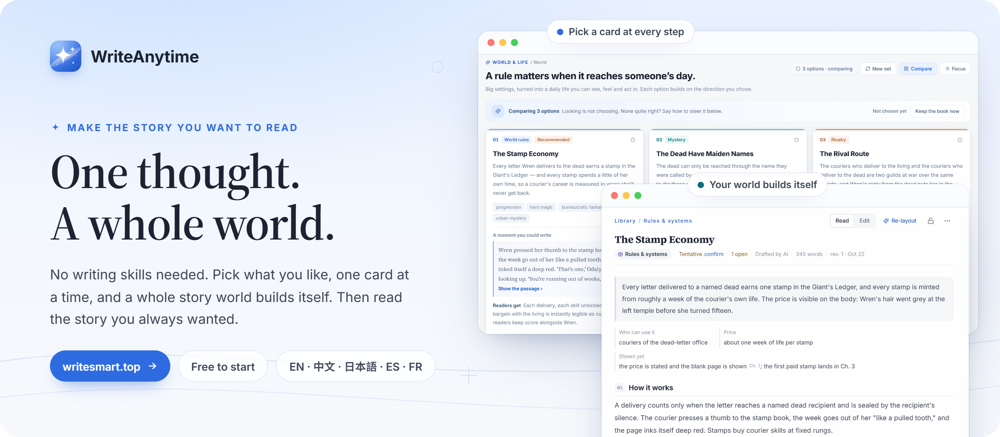
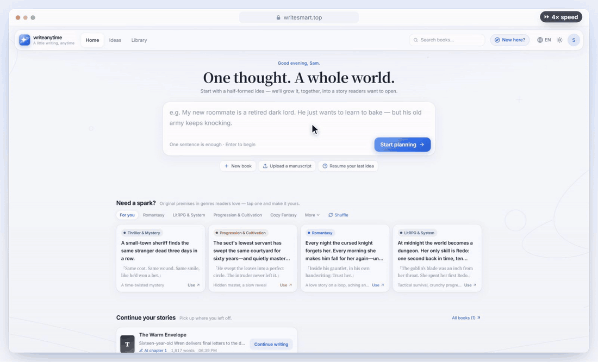
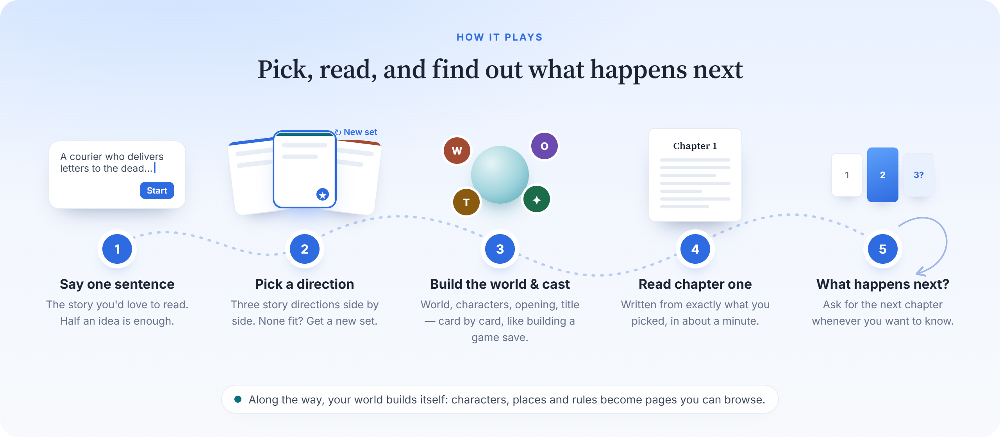
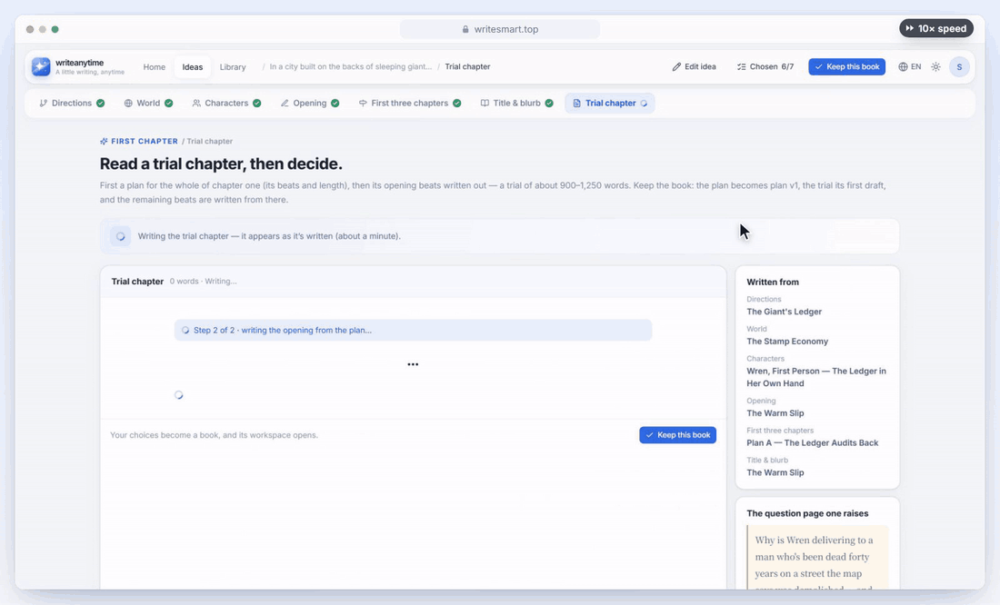
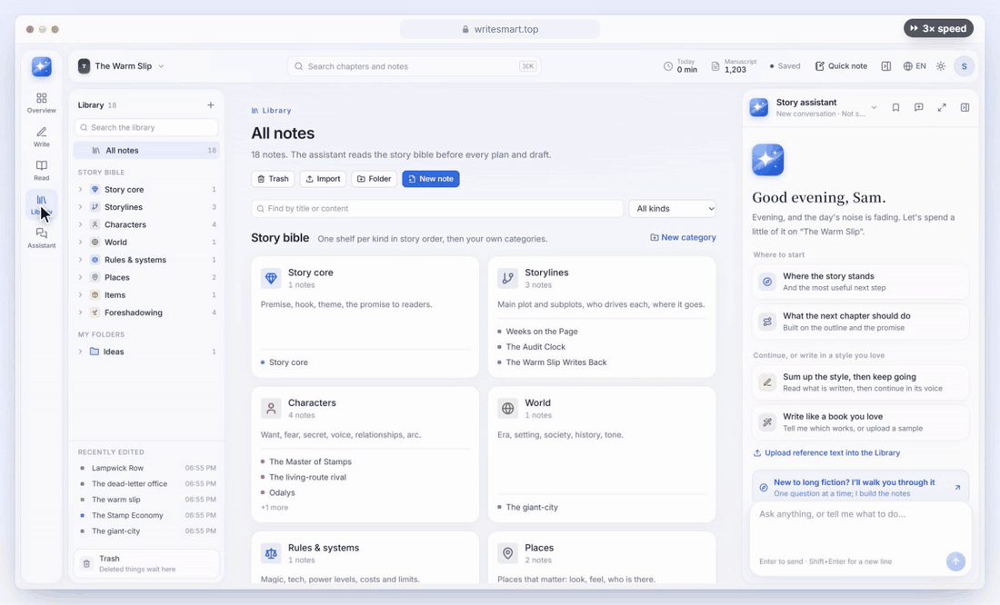
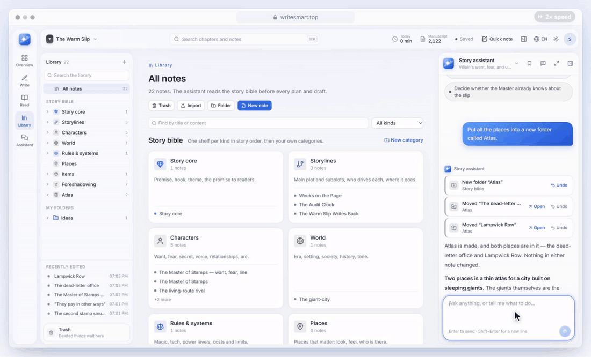
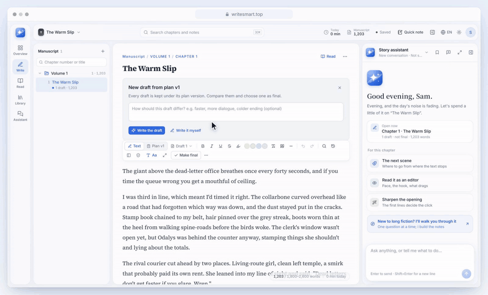
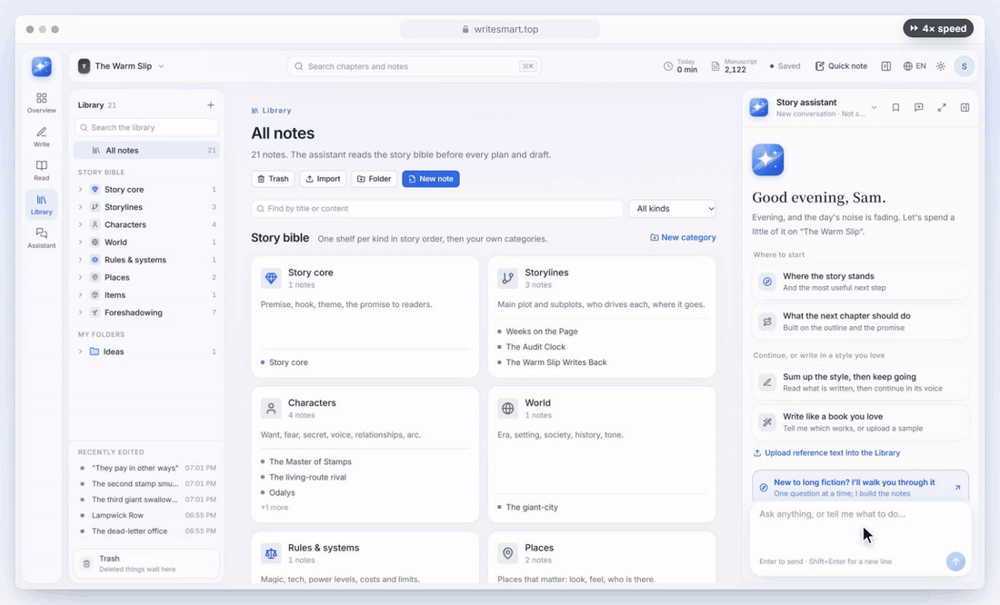
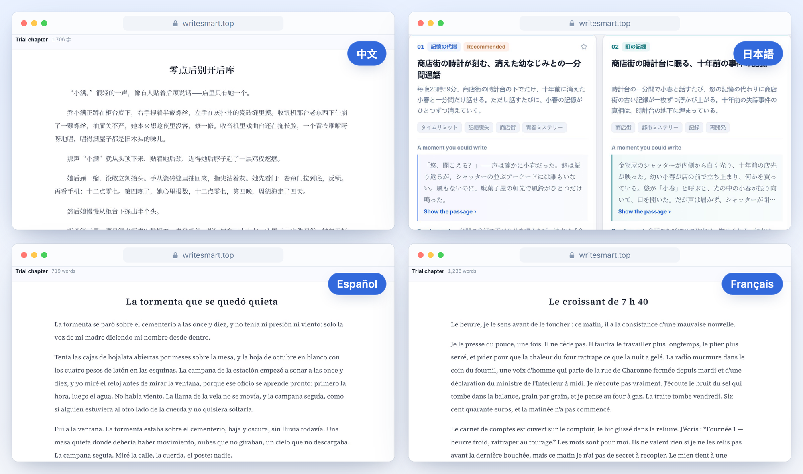

### Make the story you want to read

No writing skills needed. Pick what you like, one card at a time — like a game — 
and a whole story world builds itself. Then read the story you've always wanted.

**[Try it free at writesmart.top →](https://writesmart.top)** &nbsp;·&nbsp; [中文介绍](README.zh-CN.md)

<!-- TODO: add the 90-second tour once it is final: drag the MP4 into this README in GitHub's web editor (it becomes a video player), or link the YouTube upload here. -->

  

 

  
   
  Real product, real output. Waiting for the AI is sped up, and the badge in the corner says by how much.

## How it plays

<table>
<tr>
<td width="33%" valign="top">

**Every step is a choice**

No blank page, no questionnaire. Three options at each step — pick one, or ask for a new set.

</td>
<td width="33%" valign="top">

**The world builds itself**

Characters, places and rules become pages you can browse, and stay up to date with a click as the story goes on.

</td>
<td width="33%" valign="top">

**Just say what you want**

*“Make the villain scarier.” “Write the next chapter.”* The assistant does it, and anything can be undone.

</td>
</tr>
</table>

## Play it, scene by scene

### 1. “I've always wanted to read a story about…”

- Type one sentence: a world, a person, a strange rule. Half an idea is enough.
- Three story directions appear side by side, each with a moment you can already picture and what makes it fun to read.
- Pick one, or say how to steer and get a new set. Then do the same for the world, the characters, the opening, the first three chapters and the title.
- Your own idea is always kept as one of the options.

*(The GIF at the top of this page is this step.)*

### 2. “Just show me how it starts.”

- Chapter one is written from exactly what you picked, in about a minute.
- Like it? **Keep this book.** Not quite? Write another take, or go back and pick differently.

### 3. “Wait — who's that again?”

- Everything you picked becomes your story's own encyclopedia: characters, world rules, places, items, storylines and the secrets the story is still keeping.
- Each page reads like a game codex — a one-line summary, the facts at a glance, and the chapter it came from.

### 4. “What happens next?”

- Ask for the next chapter whenever you want to know. It picks up where the last one ended and remembers what came before.
- Read chapter by chapter in the reader, with contents and *continue reading*.
- When you settle a chapter, the assistant offers to add who and what is new to the encyclopedia — one click, one undo.

<b>Watch: the story's encyclopedia updating after a chapter</b>

 

### 5. “Change this for me.”

- Talk to the assistant in plain words: *“Make a note for our villain.” “Put all the places in a new folder.” “Plan chapter two, then write it.”*
- It shows every change it made, and each one can be undone.
- Never written a story before? A guided start asks one question at a time.

### 6. “In my own language.”

The story follows the language of your idea, not the interface. Above: chapter one from Chinese, Spanish and French ideas, and world cards from a Japanese one.

Every story shown on this page was generated from original demo ideas.

## Want to go further? It's a full writing studio too

For people who like to write and edit themselves, or who are running a long serial:

- **Write and edit yourself** — a calm editor; rewrite, expand or polish a selection; version history; one-click Chinese typesetting; focus mode; light and dark.
- **Bring a book you've started** — import `.docx`, `.md` or `.txt`, and the app reads it through and builds its encyclopedia.
- **Catch contradictions** — a continuity check flags things like a character who died walking back on stage, quoting the line so you can decide.
- **Stays quick when it gets long** — tested with a 500-chapter book: imported in 13 seconds, read through in about five minutes, encyclopedia organised in a minute, every page still answering in under 0.3 s.
- **Take it all with you** — export to Word or Markdown, or download every book as a zip.

## You stay in control

| Promise | What it means |
|---|---|
| **Your words aren't overwritten** | Changes to what you wrote arrive as suggestions you accept or not. Deleting always asks first. |
| **Undo anything** | Every change, yours or the assistant's, can be undone; old versions can be restored. |
| **Your story, your call** | Only the chapters you settle become part of the story the app remembers. |
| **Your work stays yours** | Books are private to your account, never sold and never used to train models. Download everything any time. |

**What we won't build:** one-click book factories, unattended chapter mills, automatic posting to platforms, or promises of a hit.

## Get started

1. Open **[writesmart.top](https://writesmart.top)** and type the story you'd like to read — one sentence is enough.
2. Choose **Explore the world** to pick card by card, or **Read a trial chapter** to jump straight to chapter one.
3. Pick a card at each step, or say how to steer. Skip anything you don't care about.
4. Like chapter one? **Keep this book**, then ask for the next chapter whenever you want to know what happens.

## Pricing

- **Writing, notes and organising your book by hand are free.** Always.
- **AI work uses credits**, charged for what each piece of work actually took — never for work that fails.
- **Free credits every month** for every account. Typical costs today: a set of story cards ~12 credits, an assistant reply ~32, a ~2,000-word chapter ~223.

Current packs and prices: **[writesmart.top/pricing](https://writesmart.top/pricing)**.

## FAQ

<b>Do I need to be a writer?</b>

 
No. You can make a whole story by picking cards and asking for the next chapter. If you enjoy writing, every word is yours to edit.

<b>Is WriteAnytime open source?</b>

 
No. WriteAnytime is closed source. This repository only shows what it does, and is the place for feedback and release notes.

<b>Do I need my own API key?</b>

 
No. Everything is built in.

<b>Which languages does it support?</b>

 
The interface is in English and 中文. Stories are written in the language of your idea. English and Chinese are the most tested. Japanese, Spanish and French work for picking cards and chapters; a few labels and encyclopedia pages in those books still come out in English or Chinese, and we are fixing that.

<b>Where does my writing go?</b>

 
Your books are private to your account and stored on servers in Singapore. When an AI task runs, only the parts of your book it needs are sent to the model provider. Your writing is never sold or used to train models. See the <a href="https://writesmart.top/privacy">privacy policy</a>.

<!-- whats-new -->
## What's new

- **Writing on a phone: tools on top of the keyboard, saved state and words always in view** 2026-10-24 · v0.1.42
- **On phones, back closes menus before going up a level, and menus rise from the bottom** 2026-10-24 · v0.1.41
- **Link previews, and easier to find in search** 2026-10-24 · v0.1.40
- **Easier to tap and read on phones, and ready for the home screen** 2026-10-24 · v0.1.38
- **Phones get the “update the story bible” offer after a final draft** 2026-10-24 · v0.1.37

[Every update →](CHANGELOG.md)
<!-- /whats-new -->

## Coming next

- [ ] Share your story cards with friends
- [ ] Reminders for secrets the story set up and hasn't paid off
- [ ] Sign in with Apple
- [x] Sign in with Google
- [x] Buy credits by card or Alipay
- [x] Invite friends, earn credits

Ideas are welcome — [open an issue](../../issues/new/choose).

## Feedback

- **Bugs and ideas:** [open an issue](../../issues/new/choose) in this repository.
- **Inside the app:** *Feedback* in your account menu (screenshots welcome).
- **Email:** [support@writesmart.top](mailto:support@writesmart.top)

 

  <a href="https://writesmart.top"><b>writesmart.top</b></a> · <a href="https://writesmart.top/terms">Terms</a> · <a href="https://writesmart.top/privacy">Privacy</a>
   
  © 2026 WriteAnytime. All rights reserved. This repository contains no source code; its screenshots, videos, text and designs may not be copied or reused without permission. See <a href="LICENSE">LICENSE</a>.

