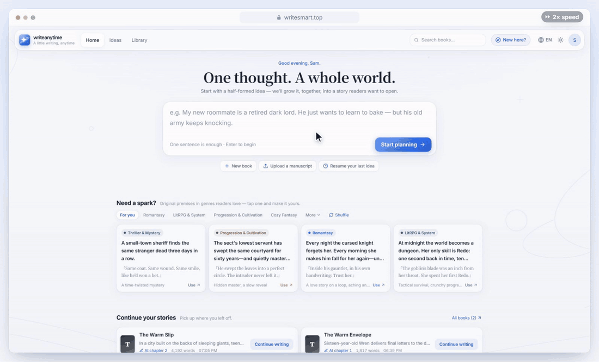
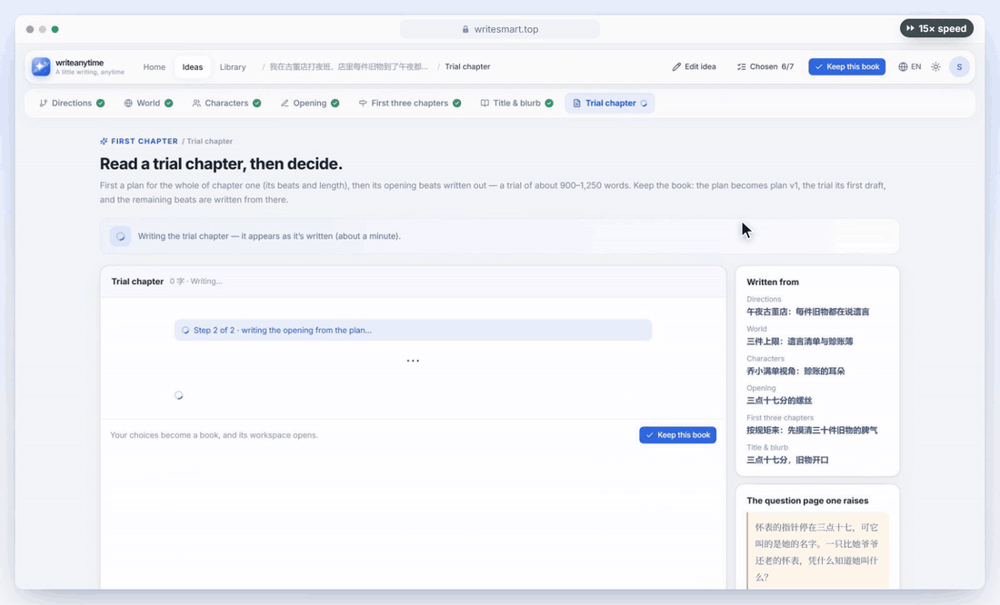
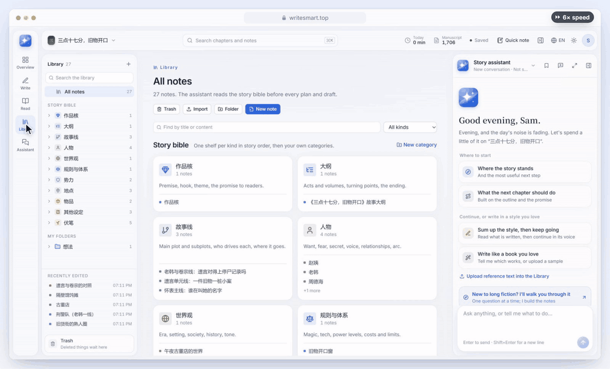

### 不会写，也能创作

像玩游戏一样一张张挑，故事世界自己长出来； 
然后读到你一直想看的那个故事。

**[免费试用 writesmart.top →](https://writesmart.top)** &nbsp;·&nbsp; [English](README.md)

<!-- TODO：90 秒介绍视频定稿后，在 GitHub 网页编辑器里把 MP4 拖进来（会变成播放器），或贴 B 站 / YouTube 链接。 -->

  

 

  
   
  真实产品、真实生成结果。等待 AI 的时间做了加速，右上角标着倍数。

## 怎么玩

<table>
<tr>
<td width="33%" valign="top">

**每一步都是选择题**

不用面对空白页，也不用填问卷。每一步三个选项，挑一个，或者换一组。

</td>
<td width="33%" valign="top">

**世界自己长出来**

人物、地点、规则都会变成能翻看的设定页，故事往下走，点一下就跟着更新。

</td>
<td width="33%" valign="top">

**想要什么直接说**

“反派再狠一点。”“写下一章。”助手直接动手，什么都能撤回。

</td>
</tr>
</table>

## 一个个场景玩下来

### 1. 「我一直想看这样一个故事……」

- 写一句话：一个世界、一个人、一条奇怪的规则都行，半个点子就够。
- 三个故事方向并排摆出来，每个都带一个你能想象出画面的瞬间，和它好看在哪里。
- 挑一个，或者说一句怎么调、再换一组。接着用同样的方式挑世界、人物、开篇、前三章和书名。
- 你原来的想法永远保留在选项里。

*（页首的动图就是这一步。）*

### 2. 「先给我看看开头。」

- 按你挑的内容写出第一章，一分钟左右。
- 喜欢就点 **收下，建书**；不满意就再写一版，或者回去换几张卡。

### 3. 「等等，这人是谁来着？」

- 你挑过的一切，都变成这个故事自己的百科：人物、世界规则、地点、物品、故事线，还有故事里埋着没揭开的伏笔。
- 每一页都像游戏图鉴：一句话简介、一眼看清的要点、出自哪一章。

### 4. 「然后呢？」

 这段和后面两段录的是英文界面，右上角可以切换成中文。

- 想知道后面发生什么，说一声就写下一章。它会从上一章结尾接着写，也记得之前发生过什么。
- 在阅读页一章章往下看，有目录，也能“继续阅读”。
- 每定下一章，助手会提出把新出场的人和事加进百科——点一下就好，也能一键撤回。

<b>看一段：定下一章后，百科跟着更新</b>

 

### 5. 「帮我改改。」

- 用大白话跟助手说：“给反派建一篇设定。”“把所有地点放进一个新文件夹。”“先写第二章企划，再写正文。”
- 它做了什么都列出来，每一步都能撤回。
- 从来没写过故事？新手引导一次只问一个问题。

### 6. 「用我自己的语言。」

故事跟着你想法的语言走，而不是跟着界面。上图：中文、西班牙语、法语想法写出的第一章，以及日语想法得到的世界卡。

本页出现的所有故事，都由原创演示想法生成。

## 想自己写、写长篇？它也是完整的写作工作台

给喜欢自己动笔、或者正在连载长篇的人：

- **自己写、自己改**：安静的编辑器；选中一段就能改写、扩写、润色；版本历史；一键中文排版；专注模式；浅色 / 深色。
- **把写了一半的书搬进来**：导入 `.docx`、`.md`、`.txt`，它会通读全书，整理出这本书的百科。
- **防吃书**：连贯性检查会标出“已经死了的人又出场”这类前后矛盾，并引用原句，由你判断。
- **写长了也不卡**：用一本 500 章的书实测：13 秒导入，约 5 分钟通读，一分钟整理好百科，每个页面依然 0.3 秒内打开。
- **随时带走**：导出 Word 或 Markdown，也能把所有作品打包下载。

## 你始终说了算

| 承诺 | 具体是 |
|---|---|
| **你写的字不会被覆盖** | 对你写过内容的改动，都以建议的形式出现，采不采用你定；删除一定先问。 |
| **什么都能撤回** | 每一次改动，不管是你的还是助手的，都能撤销；旧版本可以恢复。 |
| **故事走向你定** | 只有你定下的章节，才算进这个故事的记忆里。 |
| **作品是你的** | 作品只属于你的账号；不出售，不拿来训练模型；随时可以全部下载。 |

**我们不做的事：** 一键批量开书、无人值守连写、自动发布到平台、承诺爆款。

## 三分钟上手

1. 打开 **[writesmart.top](https://writesmart.top)**，写下你想看的故事——一句话就够。
2. 选 **先看看世界** 一张张挑卡，或者选 **先看试稿** 直接看第一章。
3. 每一步挑一张卡，或者说一句怎么调；不在乎的步骤直接跳过。
4. 喜欢第一章就 **收下，建书**，之后想看下一章，说一声就行。

## 价格

- **手写、记笔记、整理作品永远免费。**
- **AI 工作用额度**，按实际消耗扣，失败的任务不扣。
- **每个账号每月都有免费额度。** 目前的典型消耗：一组构思卡约 12，一次助手回复约 32，一章约 2,000 字的正文约 223。

额度包和价格以 **[writesmart.top/pricing](https://writesmart.top/pricing)** 为准。

## 常见问题

<b>不会写作也能用吗？</b>

 
能。只靠挑卡和“写下一章”，就能做出一个完整的故事。如果你喜欢自己写，每一个字也都可以改。

<b>开源吗？</b>

 
不开源。这个仓库只用来展示 WriteAnytime 能做什么，以及收集反馈、发布更新说明。

<b>需要自己填 API Key 吗？</b>

 
不需要，开箱即用。

<b>支持哪些语言？</b>

 
界面有中文和英文。故事用你想法的语言来写：中文和英文测得最多；日语、西班牙语、法语可以挑卡、写章节，但这几种语言的书里还有个别标签和百科页会出现英文或中文，正在修。

<b>我的作品放在哪里？</b>

 
作品只属于你的账号，存放在新加坡的服务器。执行 AI 任务时，只把需要的那部分内容发给模型服务商。我们不出售你的作品，也不拿它训练模型。详见<a href="https://writesmart.top/privacy">隐私政策</a>。

<!-- whats-new -->
## 最近更新

- **欢迎邮件和上手提示：从一个想法，走进你的世界** 2026-10-24 · v0.1.44
- **手机上多了“我的”：底部四个标签，设置变成列表** 2026-10-24 · v0.1.43
- **手机上写作更顺手：键盘上方有工具条，顶栏随时看到保存状态和字数** 2026-10-24 · v0.1.42
- **手机上返回键先关菜单、再回上一层，菜单从底部弹出** 2026-10-24 · v0.1.41
- **分享链接带预览图，更容易被搜到** 2026-10-24 · v0.1.40

[全部更新记录 →](CHANGELOG.zh-CN.md)
<!-- /whats-new -->

## 接下来要做

- [ ] 把故事卡分享给朋友
- [ ] 提醒你故事里埋下、还没揭开的伏笔
- [ ] Apple 登录
- [x] Google 登录
- [x] 银行卡和支付宝购买额度
- [x] 邀请好友得额度

欢迎提想法——[新建 Issue](../../issues/new/choose)。

## 反馈

- **Bug 和建议：** 在本仓库[新建 Issue](../../issues/new/choose)。
- **在应用里：** 账号菜单里的“反馈”（可以附截图）。
- **邮件：** [support@writesmart.top](mailto:support@writesmart.top)

 

  <a href="https://writesmart.top"><b>writesmart.top</b></a> · <a href="https://writesmart.top/terms">服务条款</a> · <a href="https://writesmart.top/privacy">隐私政策</a>
   
  © 2026 WriteAnytime，保留所有权利。本仓库不含任何源代码；其中的截图、视频、文字和设计未经许可不得复制或使用。详见 <a href="LICENSE">LICENSE</a>。

